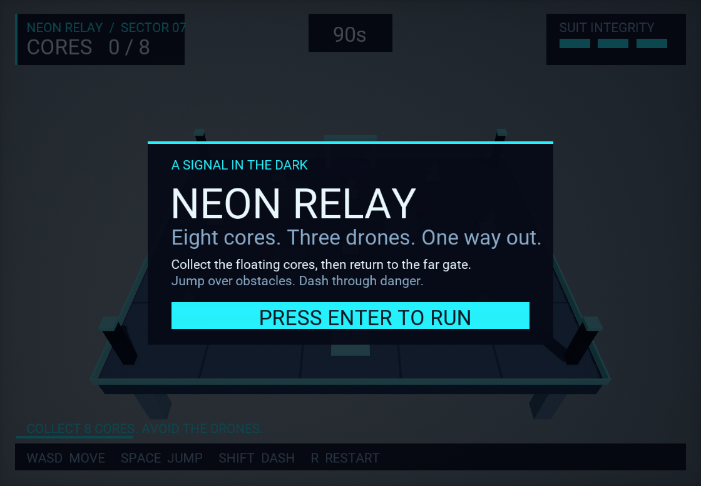

# Flax Engine MCP

A local MCP bridge for **Flax Engine 1.13**, with an editable sample game, **Neon Relay**. Built and live-tested on Windows with Flax 1.13.7012 and .NET 10.



## What it does

- Creates and edits actors, transforms, materials and scripts.
- Discovers public engine, editor and gameplay APIs; reads properties and invokes methods.
- Imports assets, creates material instances and prefabs, performs batches and editor undo/redo.
- Writes and compiles C# gameplay code, reports compilation state, reads UTF-16 editor logs.
- Controls play/pause/stop, captures viewports, and reads runtime gameplay state.
- Reads/writes project JSON assets such as game settings.

This is an early, trusted-local development bridge. Public API discovery provides broad access, but **not every engine subsystem has been exercised**. It is not a sandbox for untrusted clients or scripts.

## Quick start

Requirements: Flax 1.13, its required .NET SDK, and Node.js 20 or newer.

1. Run `npm ci` in this repository.
2. Open `examples/NeonRelay/NeonRelay.flaxproj` with Flax 1.13. The sample already includes the editor plugin.
3. Configure an MCP stdio server:

```json
{
  "mcpServers": {
    "flax": {
      "command": "node",
      "args": ["C:/path/to/Flax-Engine-MCP/src/server.js"],
      "env": {
        "FLAX_PROJECT": "C:/path/to/Flax-Engine-MCP/examples/NeonRelay",
        "FLAX_EDITOR": "C:/path/to/Flax_1.13/Binaries/Editor/Win64/Release/FlaxEditor.exe"
      }
    }
  }
}
```

For another existing project, close its editor and run:

```powershell
.\install-project.ps1 -ProjectDirectory 'D:\FlaxProjects\MyGame' -EngineDirectory 'D:\path\to\Flax_1.13'
```

Use `-Create` to create a new project directory. Installation backs up existing changed source files. The plugin is an editor-only C# module. The source tools currently target `Source/Game`.

Add the project through **Flax Launcher → Add Project** if you want it in the launcher library. The launcher's project-list file is UTF-16; do not rewrite it as UTF-8.

## Neon Relay

Collect eight energy cores, avoid three patrolling drones, and reach the far extraction gate before the timer expires.

- Enter: start
- WASD: move
- Space: jump
- Shift: dash
- R: restart

Includes collision, health, cooldowns, pickups, generated sound effects, HUD, title/loss/win states, reusable materials and a drone prefab. Open `Content/NeonRelay.scene`, then press Play. The scene remains editable.

**Validation:** live movement, grounded collision, jumping, dash distance/cooldown, pause/resume, pickups, damage, and loss were observed. The automated route collected four cores before losing to drones. Full victory/extraction, packaging, other platforms, and cross-machine portability are not yet verified. The test is intentionally left capable of failing; it does not disable hazards or teleport the player to manufacture a pass.

## Using the bridge

Start with `flax_status`, `flax_scene_tree` and `flax_inspect`. Coordinates use centimeters. Vectors use `{ "X": 0, "Y": 100, "Z": 0 }`. C# type and member names are case-sensitive.

Use `flax_types` and `flax_api` to discover APIs. Generic targets support `actor`, `script`, `asset`, `editor` and `static`, with optional dot-separated member traversal. For overloaded calls, specify `parameterTypes` exactly as returned by API discovery. References use `{ "$ref": { "kind": "actor", "id": "..." } }`; boxed values use `{ "$type": "FlaxEngine.Color", "value": { "R": 1, "G": 0, "B": 0, "A": 1 } }`.

`flax_wait` and status help verify asynchronous compilation and play transitions. Source writes request compilation but do not imply compilation success. Inspect `compiling` and `compilationFailed`.

Game screenshots capture the render task. Neon Relay uses a camera-space HUD so it is included. Screen-space UI composited later by the editor may be absent from these captures.

## Reliability and limitations

Requests are written atomically to `Cache/McpBridge` and processed on the editor main thread. One editor owns a project queue. Started/completed/failed receipts prevent automatic replay after a crash. After a timeout, inspect `flax_receipt` instead of repeating an edit. A failed batch or multi-property edit may have partially applied.

STOP persists across restarts and blocks bridge mutations until explicit resume. Generic property changes do not yet create undo records; actor creation/deletion use editor undo. Save explicitly. Scene opening is additive. Logs and receipts are retained locally.

The plugin runs with the editor user's permissions. Generic API calls and generated C# are powerful; expose this server only to trusted local clients. No network listener or model API key is required.

Engine tools for terrain, animation graphs, navigation baking, material graphs and packaged builds are not yet covered by dedicated workflows or complete tests. The installed test machine reported missing optional Android/Web/Vulkan/ARM64 components; Windows x64 C# compilation worked.

## Tests and development

- `npm test`: source path and receipt validation.
- `npm run smoke`: modifies a disposable project, creating/deleting a test cube and writing `BridgeMotion.cs`. Set `FLAX_PROJECT` to a test project with an open scene.
- `node tests/gameplay.js`: Neon Relay movement-based integration test, including a complete-route attempt.
- `game/build-arena.js`: original scene-construction recipe; refuses to overwrite an existing arena. Development recipes currently include original machine paths and must be adapted before regeneration elsewhere.

`VALIDATION.json` records the earlier bridge smoke pass. `GAMEPLAY-VALIDATION.json` records the current game's partial playtest. Generated caches, binaries, credentials and machine-local MCP configuration are excluded.

Flax Engine and its bundled resources remain subject to their own license. The repository does not include the engine installation. See [Flax documentation](https://docs.flaxengine.com/) and [MCP TypeScript SDK](https://github.com/modelcontextprotocol/typescript-sdk).
